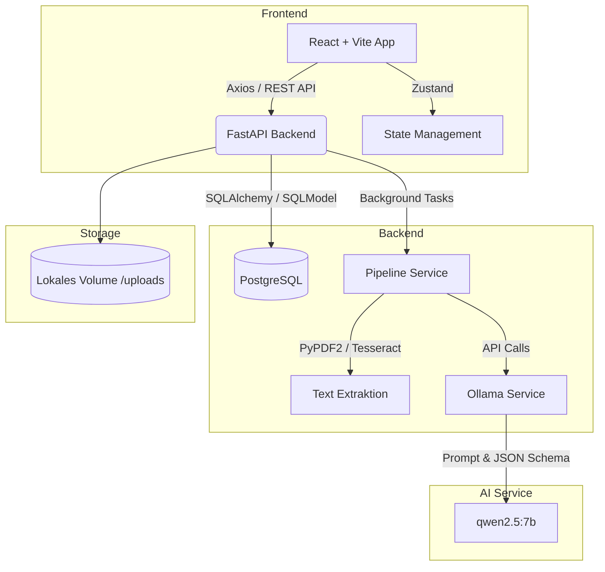
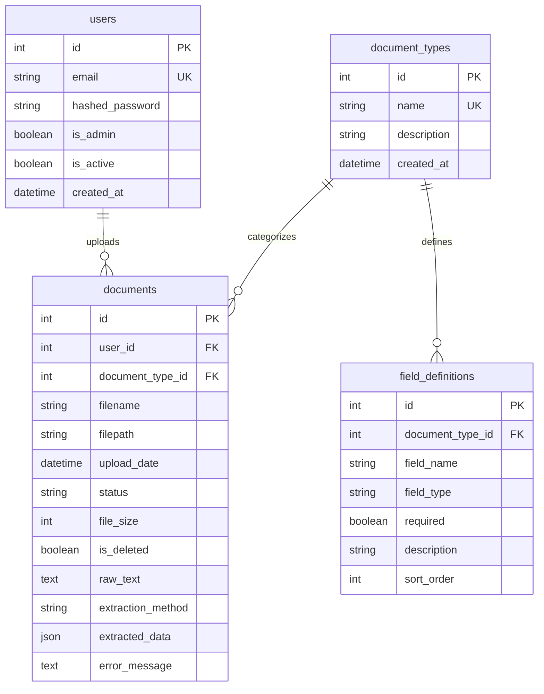

# DocuMind

DocuMind ist eine interne Web-Anwendung zur intelligenten Dokumentenanalyse.
Sie ermöglicht das Hochladen von PDFs, extrahiert den Text (via PyPDF2 und
Tesseract OCR) und mappt die Inhalte mithilfe eines lokalen Large Language
Models (Ollama) in strukturierte JSON-Daten, die auf dynamisch
konfigurierbaren Dokumenttypen basieren.

## Architektur

Das System besteht aus mehreren gekoppelten Docker-Containern:



### Datenbank-Struktur

Die relationale Datenbank (PostgreSQL) nutzt folgendes Schema, um Benutzer, Dokumente und dynamische Felddefinitionen abzuspeichern:



### Komponenten

- **Frontend:** React, TypeScript, Vite, Tailwind CSS v4,
  Zustand (State Management), React Router v6.
- **Backend:** FastAPI, SQLModel, Uvicorn, Passlib (Authentifizierung).
- **Datenbank:** PostgreSQL 16.
- **AI / LLM:** Ollama (default: `qwen2.5:7b`) mit GPU-Passthrough.
- **Infrastruktur:** Docker Compose (`documind-network`).

## Quickstart

### Voraussetzungen

- [Docker](https://docs.docker.com/get-docker/) &
  [Docker Compose](https://docs.docker.com/compose/install/)
- Für GPU-Beschleunigung:
  [NVIDIA Container Toolkit](https://docs.nvidia.com/datacenter/cloud-native/container-toolkit/latest/install-guide.html)

### Installation & Start

1. **Repository klonen**

   ```bash
   git clone https://codeberg.org/DerKumpel/documind.git
   cd documind
   ```

2. **Umgebungsvariablen konfigurieren**

   Kopieren Sie die `.env.example` nach `.env` und passen Sie gegebenenfalls
   Werte an:

   ```bash
   cp .env.example .env
   ```

3. **Services starten**

   ```bash
   docker-compose up --build -d
   ```

   *Hinweis: Beim ersten Start wird das Ollama-Modell heruntergeladen,
   dies kann einige Minuten dauern.*

4. **Anwendung aufrufen**

   - Frontend: [http://localhost:5173](http://localhost:5173)
   - Backend API Docs: [http://localhost:8000/docs](http://localhost:8000/docs)

### Datenbank-Migrationen (Alembic)

Wenn sich das Datenbank-Schema ändert (z. B. durch neue Spalten in Modellen), müssen diese Änderungen mit Alembic angewendet werden. Da das Backend in einem Docker-Container läuft, werden die Befehle innerhalb des Containers ausgeführt.

1. **Neue Migration erstellen** (nur nötig, wenn Modelle in `backend/app/models/` geändert wurden):

   ```bash
   docker exec documind-backend alembic revision --autogenerate -m "Beschreibung der Änderung"
   ```

2. **Migrationen anwenden** (um die Datenbankstruktur auf den neuesten Stand zu bringen):

   ```bash
   docker exec documind-backend alembic upgrade head
   ```

## API-Dokumentation (Übersicht)

Die vollständige Swagger-Dokumentation ist unter `/docs` verfügbar, sobald
das Backend läuft.

- **Authentifizierung**
  - `POST /auth/register` – Neuen Benutzer registrieren.
    (Der erste User wird automatisch Admin).
  - `POST /auth/login` – Login, gibt ein JWT-Token zurück.

- **Dokumente**
  - `POST /documents/upload` – PDF hochladen & Analyse starten.
  - `GET /documents` – Liste der eigenen Dokumente abrufen.
  - `GET /documents/{id}` – Details eines Dokuments inkl. Status abrufen.
  - `PUT /documents/{id}` – Extrahierte JSON-Daten aktualisieren.
  - `DELETE /documents/{id}` – Dokument & Datei löschen.

- **Admin (nur für Administratoren)**
  - `GET /admin/document-types` – Dokumenttypen verwalten.
  - `POST /admin/document-types` – Neuen Dokumenttyp anlegen.
  - `POST /admin/document-types/{id}/fields` – Felddefinitionen hinzufügen.

## Fehlerbehandlung & Edge Cases (Phase 5)

- Beschädigte PDFs werden vom Backend erkannt und im Status als `error`
  markiert.
- Bei Ausfall des Ollama-Services wird der Fehler im Frontend kommuniziert,
  und Dokumente können später erneut verarbeitet werden.
- Bei leerem Text-Output aus dem OCR-Prozess wird ein entsprechender Fehler
  geloggt.

## Ausblick: Deployment in Produktion (Kubernetes)

Um das Projekt aus der lokalen Docker-Umgebung in ein produktives **Kubernetes (K8s)** Setup zu überführen, sind folgende architektonische Schritte geplant:

- **Frontend-Optimierung:** Umstellung auf einen Multi-Stage Docker-Build (Build mit Node, Auslieferung via Nginx) anstelle des Vite Dev-Servers.
- **Ressourcen & Skalierung:** Frontend und Backend werden als Kubernetes **Deployments** konfiguriert. Konfiguration (Env-Variablen) und Secrets werden über **ConfigMaps** und **Secrets** verwaltet.
- **Persistenz:** Die PostgreSQL Datenbank, Ollama-Modelle und Dateiuploads werden über **StatefulSets** und **PersistentVolumeClaims (PVC)** angebunden oder (in Cloud-Umgebungen) an Managed Services wie AWS RDS und S3 delegiert.
- **Routing:** Ein **Ingress Controller** fungiert als Reverse Proxy für SSL-Terminierung und Routing zwischen Frontend- und Backend-Services.
- **Hardware-Anforderungen (LLM):** Um eine angemessene Inferenz-Geschwindigkeit zu gewährleisten, erfordert das Deployment von Ollama Kubernetes-Nodes mit GPU-Unterstützung (z.B. via NVIDIA Device Plugin).
